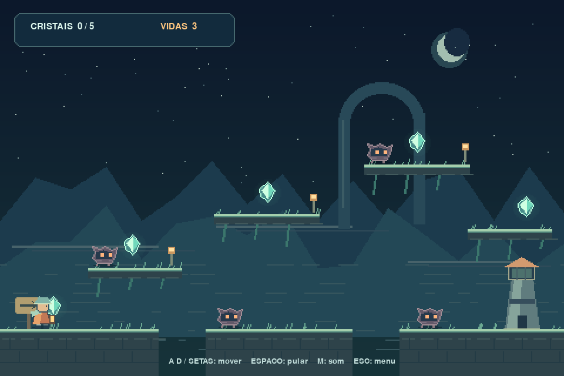

# Farol da Névoa

Um pequeno **platformer** em PgZero. Você é um guardião que precisa recuperar
cinco cristais para reacender o farol. As sentinelas patrulham as ruínas;
observe suas pausas para encontrar uma passagem segura.



## Executar

Use **Python 3.12**, versão com a qual o projeto foi verificado. Baixe ou clone
o repositório, abra um terminal na pasta que contém `game.py` e execute:

```console
python -m pip install -r requirements.txt
python game.py
```

Se houver várias versões de Python no Windows e a 3.12 estiver instalada:

```console
py -3.12 -m pip install -r requirements.txt
py -3.12 game.py
```

Também é possível iniciar com `pgzrun game.py`. Mantenha `images`, `sounds` e
`music` ao lado do código. Depois da instalação, o jogo funciona sem internet.

## Controles e regras

| Controle | Ação |
| --- | --- |
| A / D ou setas esquerda / direita | Andar |
| Espaço, W ou seta para cima | Pular quando estiver apoiado |
| M | Ligar/desligar música e efeitos juntos |
| Esc | Voltar ao menu; começar inicia uma nova partida |
| Botão esquerdo do mouse | Acionar os botões do menu |

- Recolha os **cinco cristais** e alcance o farol no chão, à direita.
- Encostar em qualquer sentinela ou cair em um vão custa uma vida.
- Você tem três vidas. Após perder uma, retorna ao início com dois segundos
  de proteção contra sentinelas; os cristais recolhidos continuam com você.
- A proteção não impede a perda de vida em quedas.
- Sem vidas, clique em **Jogar novamente** para reiniciar tudo.
- Dica: alcance a borda esquerda da primeira plataforma e observe a patrulha
  antes de saltar por cima dela. Na última plataforma suspensa, saia pela
  borda esquerda e volte para a direita depois de descer.

## Organização

```text
farol_da_nevoa/
  game.py              # Código completo do jogo
  requirements.txt     # PgZero
  images/              # 41 PNGs originais; 32 são quadros de personagens
  sounds/              # Cinco efeitos WAV originais
  music/beacon.ogg      # Trilha original em loop
  preview.png          # Captura do jogo em execução
  VERIFICACAO.md       # Requisitos e resultados dos testes
  README.md
```

`AnimatedCharacter` troca ciclicamente os quadros de animação.
`Player` implementa movimento, gravidade, saltos e colisões.
`Sentinel` implementa a patrulha e as pausas em um território delimitado.
O código usa nomes em inglês e segue PEP8.

As plataformas são sólidas. A física usa passos de no máximo 1/120 de segundo
para diminuir o risco de atravessar obstáculos. Pausas muito longas da janela
limitam o avanço da simulação a 0,1 segundo por atualização.

O único módulo importado além do PgZero é `pygame.Rect`, permitido pelo
enunciado. PgZero instala suas próprias dependências internamente; o código
do jogo não usa outras partes da API de Pygame.

## Referências de API

[PgZero](https://pygame-zero.readthedocs.io/en/stable/),
[objetos internos](https://pygame-zero.readthedocs.io/en/stable/builtins.html),
[eventos](https://pygame-zero.readthedocs.io/en/stable/hooks.html).
